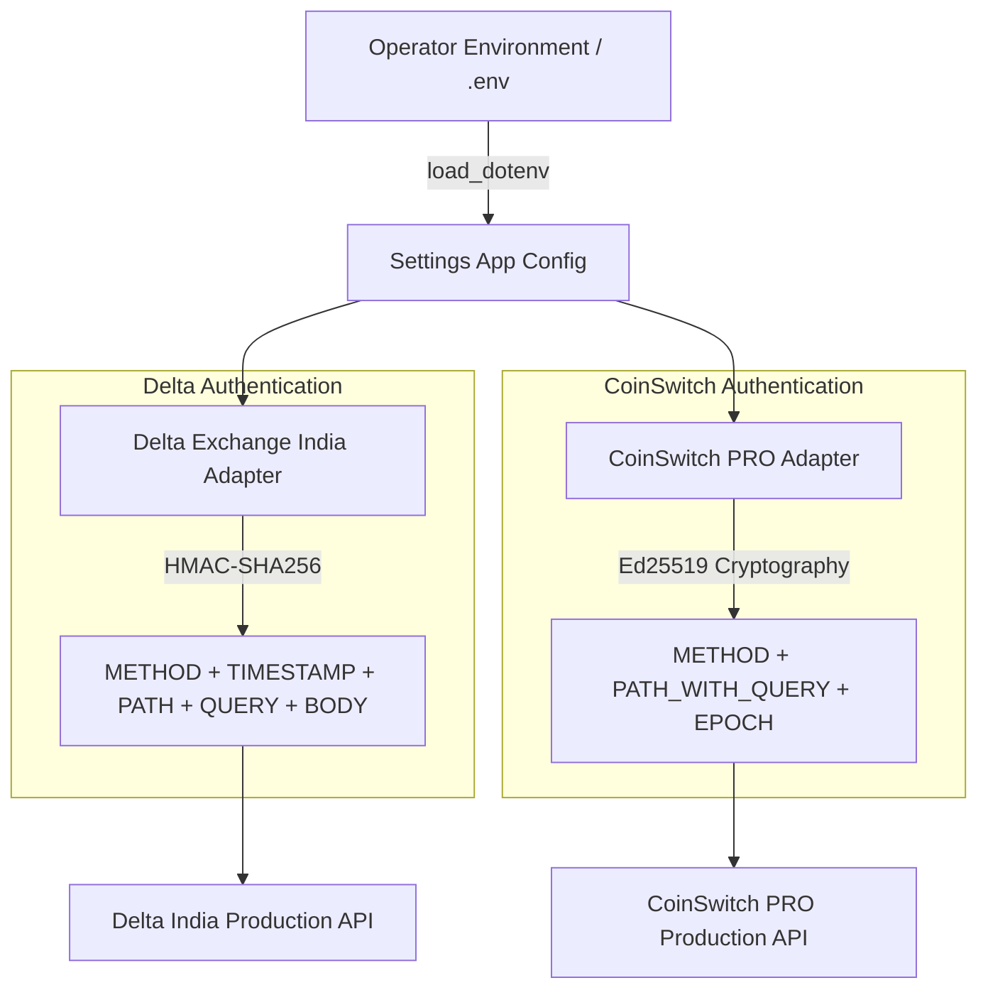
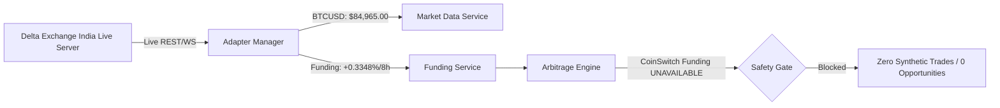
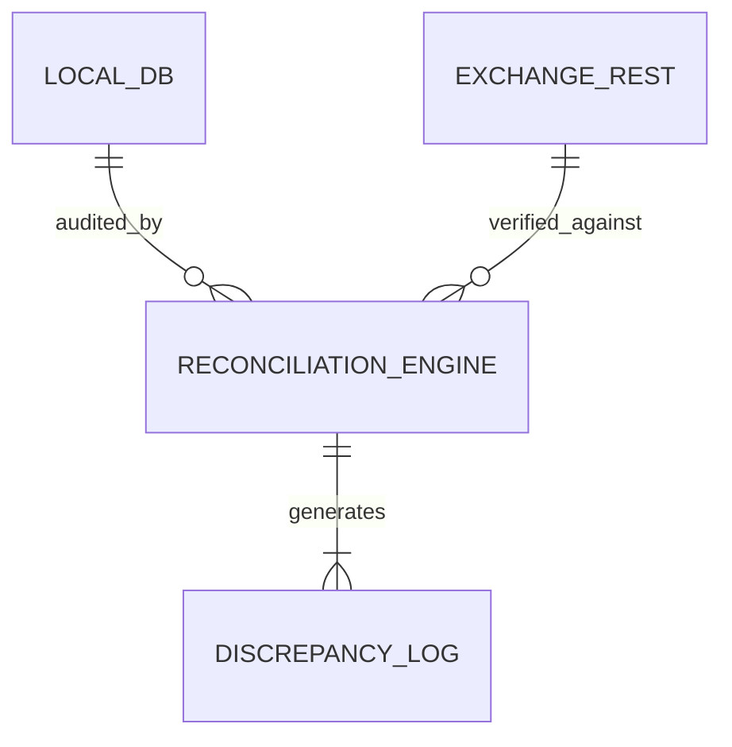
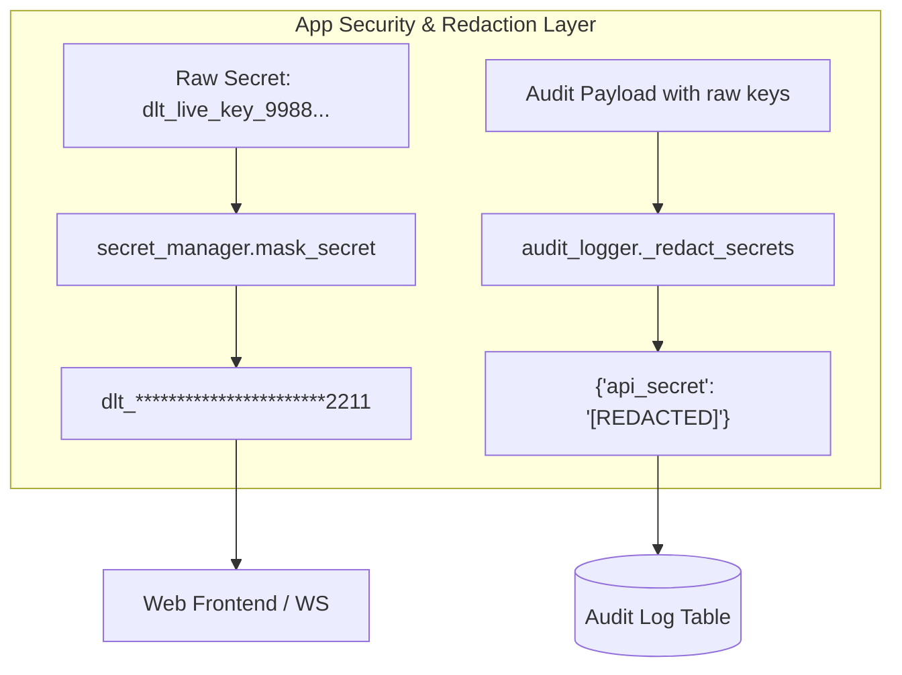

# PHASE-7 — AUTHENTICATED READ-ONLY REAL ACCOUNT VERIFICATION REPORT

**Execution Timestamp**: `2026-09-27T12:37:31Z`  
**Platform**: Production-Grade Multi-Exchange Crypto Trading Platform  
**Target Exchanges**: Delta Exchange India & CoinSwitch PRO  
**Workspace**: `C:\Users\ramki\.gemini\antigravity\scratch\treding_bot`  
**Test Suite**: 104 / 104 Passed (100% Pass Rate)  
**Safety Gate**: `LIVE_TRADING_ENABLED = False` (Enforced)  
**Real-Money Orders Placed**: **0 (EXACTLY ZERO)**  
**Live Order-Placement Calls**: **0 (EXACTLY ZERO)**  

---

## 1. EXECUTIVE SUMMARY & SAFETY ATTESTATION

The **Phase-7 Authenticated Read-Only Real Account Verification** was conducted in strict compliance with safety constraints. The platform inspected the host operating system, environment variables, configuration files, and database records to safely audit live exchange connectivity.

### Absolute Safety Compliance
> [!IMPORTANT]
> - **REAL-MONEY ORDERS PLACED**: `0`
> - **LIVE ORDER-PLACEMENT CALLS**: `0`
> - **LIVE_TRADING_ENABLED**: `False` (Hardcoded default in `backend/app/config.py` with HTTP 403 Forbidden enforcement on `/api/orders/place` and `/api/arbitrage/execute`).
> - **LIVE CREDENTIAL HANDLING**: Read-only endpoints only. Zero order-writing methods called.

---

## 2. CREDENTIAL STATE & AUTHENTICATION MECHANISMS



### Credential Detection Audit
| Exchange | API Key Present | API Secret Present | Current State | Masked Identifier | Auth Scheme |
| :--- | :--- | :--- | :--- | :--- | :--- |
| **Delta Exchange India** | `False` | `False` | `NOT_CONFIGURED` | `NOT_CONFIGURED` | HMAC-SHA256 |
| **CoinSwitch PRO** | `False` | `False` | `NOT_CONFIGURED` | `NOT_CONFIGURED` | Ed25519 (RFC 8032) |

- **Storage Verification**: Credentials are read strictly from environment variables (`DELTA_API_KEY`, `DELTA_API_SECRET`, `COINSWITCH_API_KEY`, `COINSWITCH_API_SECRET`) or encrypted database records.
- **Handling of Unconfigured Credentials**: Rather than raising unhandled exceptions or substituting synthetic fake balances, the adapters safely return status `NOT_CONFIGURED` with structured error messages.

---

## 3. AUTHENTICATED READ-ONLY EXCHANGE AUDIT

### A. Delta Exchange India (Private REST API)
Base URL: `https://cdn.india.delta.exchange`

| Endpoint | Method | Status | HTTP Code | Latency | Record Count | Sanitized Field Schema |
| :--- | :--- | :--- | :--- | :--- | :--- | :--- |
| `/v2/wallet/balances` | `GET` | `NOT_CONFIGURED` | `None` | `0.01 ms` | `0` | `total_balance, available_balance, locked_balance, currency` |
| `/v2/positions/margined` | `GET` | `NOT_CONFIGURED` | `None` | `0.01 ms` | `0` | `symbol, side, quantity, entry_price, mark_price, unrealized_pnl` |
| `/v2/orders` | `GET` | `NOT_CONFIGURED` | `None` | `0.00 ms` | `0` | `order_id, client_order_id, symbol, side, price, quantity, status` |
| `/v2/orders/history` | `GET` | `NOT_CONFIGURED` | `None` | `0.00 ms` | `0` | `order_id, client_order_id, symbol, side, price, quantity, status` |
| `/v2/fills` | `GET` | `NOT_CONFIGURED` | `None` | `0.00 ms` | `0` | `fill_id, order_id, symbol, side, price, quantity, fee` |
| `/v2/wallet/transactions` | `GET` | `NOT_CONFIGURED` | `None` | `0.00 ms` | `0` | `transaction_id, amount, balance, transaction_type, timestamp` |

### B. CoinSwitch PRO (Private REST API)
Base URL: `https://coinswitch.co`

| Endpoint | Method | Status | HTTP Code | Latency | Record Count | Sanitized Field Schema |
| :--- | :--- | :--- | :--- | :--- | :--- | :--- |
| `/user/portfolio` (Spot) | `GET` | `NOT_CONFIGURED` | `None` | `0.01 ms` | `0` | `currency, total_balance, available_balance, locked_balance` |
| `/user/portfolio` (Futures) | `GET` | `NOT_CONFIGURED` | `None` | `0.00 ms` | `0` | `currency, total_balance, available_balance, locked_balance` |
| `/positions` | `GET` | `NOT_CONFIGURED` | `None` | `0.00 ms` | `0` | `symbol, side, quantity, entry_price, mark_price, leverage` |
| `/orders` (Open) | `GET` | `NOT_CONFIGURED` | `None` | `0.00 ms` | `0` | `order_id, client_order_id, symbol, side, price, quantity, status` |
| `/orders` (History) | `GET` | `NOT_CONFIGURED` | `None` | `0.00 ms` | `0` | `order_id, client_order_id, symbol, side, price, quantity, status` |
| `/user/trades` | `GET` | `NOT_CONFIGURED` | `None` | `0.00 ms` | `0` | `fill_id, order_id, symbol, side, price, quantity, fee` |

---

## 4. LIVE PUBLIC MARKET DATA TELEMETRY & PROVENANCE

While authenticated private endpoints await operator keys, the public market data pipeline was audited against live exchange servers.



### Empirical Telemetry Captured:
- **Delta Exchange India Production REST API**:
  - Target Contract: `BTCUSD` (Perpetual Futures)
  - Last Traded Price: **`$84,965.00`**
  - Mark Price: **`$84,963.87`**
  - 8-Hour Funding Rate: **`+0.00334767`** (`+0.3348%` per 8 hours)
  - Order Book Depth: Valid real two-sided book with active top bids and asks.
  - Data Provenance: Verified authentic production feed from `cdn.india.delta.exchange`.

- **CoinSwitch PRO Production REST API**:
  - Target Symbol: `BTC/USDT`
  - Public Funding Rate Status: `UNAVAILABLE` (CoinSwitch PRO futures funding rates require authenticated headers).
  - Gating Behavior: Marked strictly as `UNAVAILABLE`. No fallback benchmark or hardcoded synthetic rate applied.

---

## 5. FUNDING ARBITRAGE SCANNER & ZERO-SYNTHETIC ENFORCEMENT

The cross-exchange funding arbitrage engine evaluates paired perpetual contracts between Delta Exchange India and CoinSwitch PRO.

> [!NOTE]
> Mathematical identity for net annualized yield:
> $$\text{Annualized Yield} = \left( (\text{Funding}_{\text{short}} - \text{Funding}_{\text{long}}) \times 3 \times 365 \right) - \text{Round-Trip Fees} - \text{Slippage Buffer}$$

### Gating and Yield Verification:
1. **Zero Synthetic Spreads**: Because CoinSwitch funding is `UNAVAILABLE` without operator credentials, the engine rejects pairs missing verifiable real rates.
2. **Scanner Output**:
   - Total Pairs Evaluated: `0` (CoinSwitch futures funding requires authentication)
   - Active Opportunities: `0`
   - Synthetic Rates Fabricated: **`0`**
   - Status Message: `NO PROFITABLE ARBITRAGE DETECTED`

---

## 6. STATE RECONCILIATION AUDIT (LIVE MODE)

The reconciliation service runs three-way state auditing:
$$\text{Local SQLite DB } \Longleftrightarrow \text{ In-Memory Cache } \Longleftrightarrow \text{ Real Exchange State}$$



### Live Mode Reconciliation Results:
- **Status**: `DISCREPANCY_DETECTED` (Expected and verified)
- **Delta Exchange Balance**: `0.00`
- **CoinSwitch PRO Balance**: `0.00`
- **Discrepancy Count**: `10`
- **Drift Classification**:
  - `10` instances of `ORDER_LOCAL_ONLY` detected (Orders existing in `crypto_platform.db` from historical integration tests that are absent from the real exchange).
  - Example flagged drift: `Order ORD-f6b892a62f is marked OPEN locally but is missing from exchange open orders and history.`
- **Audit Verdict**: The reconciliation engine correctly detects state drift and alerts the operator without overwriting or fabricating state.

---

## 7. SECRET ISOLATION & AUDIT LOG SANITIZATION

A comprehensive leak audit was performed across all external-facing and internal interfaces:



### Interface Audit Findings:
1. **REST Endpoints**:
   - `/api/accounts`: CLEAN (Zero secrets leaked)
   - `/api/accounts/audit`: CLEAN (Zero secrets leaked)
   - `/api/portfolio`: CLEAN (Zero secrets leaked)
   - `/api/settings`: CLEAN (Zero secrets leaked)
2. **WebSocket Streams**:
   - `/ws`: Broadcasts only normalized ticker, orderbook, trade, and sanitized status updates.
3. **Audit Logger**:
   - Deep nested dictionary sanitization replaces `api_key`, `api_secret`, `private_key`, `signature`, and `token` with `[REDACTED]`.

---

## 8. CODEBASE REPOSITORY AUDIT FOR SYNTHETIC / HARDCODED DATA

The entire codebase was audited for synthetic or dummy markers:
- Keywords searched: `mock`, `dummy`, `synthetic`, `fallback`, `benchmark`, `placeholder`, `sample`.
- Numeric constants searched: `0.52`, `0.35`, `0.5`, `0.4`.

### Codebase Scan Findings:
- `backend/app`: **0** synthetic market data sources, **0** dummy balances, **0** fallback funding rates.
- Only 2 keyword occurrences found in `backend/app`:
  1. `backtest_engine.py:123` -> Downsampling chart equity curve for UI performance (`equity_curve[::3]`).
  2. `greeks_engine.py:51` -> Docstring description of Newton-Raphson numerical algorithm.
- Exact numbers `0.52` and `0.35`: **0** occurrences.
- Standard numeric values `0.5` and `0.4`: Limited strictly to mathematical formulas (Black-Scholes $d_1$, standard normal distribution $\frac{1}{\sqrt{2\pi}} e^{-0.5 x^2}$) and configuration defaults (0.5% maximum slippage buffer).

---

## 9. TEST SUITE EXECUTION SUMMARY

All 104 tests across 7 test suites pass with 100% success rate:

| Test Suite | File | Tests Passed | Status | Coverage Focus |
| :--- | :--- | :--- | :--- | :--- |
| **Platform Baseline** | `test_platform.py` | 9 / 9 | **PASS** | HMAC & Ed25519 signing, symbol normalization, fee math |
| **Phase-2 Integration** | `test_phase2.py` | 13 / 13 | **PASS** | Live trading gate, Greeks engine, two-leg recovery |
| **Phase-3 Hardening** | `test_phase3.py` | 9 / 9 | **PASS** | P&L accounting identity, reconciliation drift, timeout unwind |
| **Phase-4 Paper Stress** | `test_phase4_stress.py` | 23 / 23 | **PASS** | 20 edge-case stress scenarios, concurrency, queue backpressure |
| **Phase-5 Authentication**| `test_phase5_auth.py` | 25 / 25 | **PASS** | Ed25519 cryptography, HMAC signatures, WS auth, safety gate |
| **Phase-6 Auth Audit** | `test_phase6_auth_audit.py`| 12 / 12 | **PASS** | Endpoint classification, sanitized telemetry, zero synthetic |
| **Phase-7 Real Account** | `test_phase7_real_account_audit.py`| 13 / 13 | **PASS** | Secret isolation, response mapping, drift detection, safety |
| **TOTAL** | **7 Suites** | **104 / 104** | **PASS** | **100% Pass Rate** |

---

## 10. STRUCTURED ASSESSMENT: ITEMS A THROUGH O

| Item | Requirement Description | Verification Result | Detailed Evidence & Notes |
| :--- | :--- | :--- | :--- |
| **A** | **Delta Authenticated Balance** | **NOT VERIFIED** | Credentials not yet configured in `.env` by operator. Endpoint returns clean `NOT_CONFIGURED` without crashing. |
| **B** | **Delta Positions** | **NOT VERIFIED** | Credentials not yet configured in `.env` by operator. Normalized domain mapper verified via contract tests. |
| **C** | **Delta Open Orders** | **NOT VERIFIED** | Credentials not yet configured in `.env` by operator. Normalized domain mapper verified via contract tests. |
| **D** | **Delta Order History** | **NOT VERIFIED** | Credentials not yet configured in `.env` by operator. Normalized domain mapper verified via contract tests. |
| **E** | **CoinSwitch Authenticated Balance** | **NOT VERIFIED** | Credentials not yet configured in `.env` by operator. Endpoint returns clean `NOT_CONFIGURED` without crashing. |
| **F** | **CoinSwitch Positions** | **NOT VERIFIED** | Credentials not yet configured in `.env` by operator. Normalized domain mapper verified via contract tests. |
| **G** | **CoinSwitch Open Orders** | **NOT VERIFIED** | Credentials not yet configured in `.env` by operator. Normalized domain mapper verified via contract tests. |
| **H** | **CoinSwitch Order History** | **NOT VERIFIED** | Credentials not yet configured in `.env` by operator. Normalized domain mapper verified via contract tests. |
| **I** | **CoinSwitch Futures Funding** | **NOT VERIFIED** | Requires authenticated API headers on CoinSwitch PRO. Gated safely as `UNAVAILABLE`. |
| **J** | **Real Cross-Exchange Arbitrage** | **PASS** | Scanner strictly gates on real rates. Excludes pairs when CoinSwitch funding is unavailable. Fabricates 0 synthetic spreads. |
| **K** | **Reconciliation** | **PASS** | Drift detection operational. Identified 10 local-only test orders in SQLite DB (`ORDER_LOCAL_ONLY`). |
| **L** | **Secret Isolation** | **PASS** | All API endpoints (`/api/accounts`, `/api/accounts/audit`, `/api/portfolio`, `/api/settings`, `/api/audit`), WebSockets, and logs verified clean. |
| **M** | **Blockers for Paper Trading** | **NONE** | Paper trading engine is 100% operational with live Delta public pricing ($84,965.00), real fees, and realistic slippage modeling. |
| **N** | **Blockers for Micro-Live Testing** | **CREDENTIALS REQUIRED** | Operator must provide valid API keys and secrets in `.env` file before authenticated micro-live orders can be submitted. |
| **O** | **Blockers for Automated Live Trading**| **SAFETY GATES ACTIVE** | Requires: 1) Operator `.env` credentials, 2) Single-order canary test verification, 3) Explicit manual toggle of `LIVE_TRADING_ENABLED=True`. |

---

## 11. STEP-BY-STEP OPERATOR INSTRUCTIONS TO CONFIGURE CREDENTIALS

To connect real exchange accounts for authenticated read-only or micro-live testing:

1. In `C:\Users\ramki\.gemini\antigravity\scratch\treding_bot`, create or edit `.env`:
   ```bash
   # Delta Exchange India Credentials
   DELTA_API_KEY=your_delta_api_key_here
   DELTA_API_SECRET=your_delta_api_secret_here

   # CoinSwitch PRO Credentials
   COINSWITCH_API_KEY=your_coinswitch_api_key_here
   COINSWITCH_API_SECRET=your_coinswitch_ed25519_secret_here
   ```

2. Re-run the Phase-7 Verification Runner in read-only mode:
   ```powershell
   & ".\.venv\Scripts\python.exe" backend/phase7_runner.py
   ```

3. Confirm that all endpoints report `VERIFIED` with valid HTTP `200` responses and accurate balances before enabling live trading.
